# Project notes

Notes for this fork of openZmeter: Fluvius S1 port support, running on a Raspberry Pi 4, and how data flows through
the software. User-facing instructions are in the [main README](../README.md) and the
[S1 driver README](../Service/Source/Devices/S1/README.md).

## 1. Software architecture and data flow

```mermaid
flowchart LR
  subgraph HW["Hardware"]
    METER["Fluvius digital meter<br/>S1 port, RJ12"]
    ADAPTER["USB to RS-422 adapter<br/>2 Mbaud"]
    BOARDS["openZmeter capture boards<br/>V1 / V2 / V3, USB"]
  end

  subgraph DEV["Device drivers (one thread each)"]
    S1SER["DeviceS1Serial<br/>raw 8N1 at 2 Mbaud"]
    S1PARSE["DeviceS1Parser<br/>frame sync, X.25 CRC, decode"]
    S1PROC["DeviceS1::ProcessFrame<br/>mode detection, gap fill,<br/>invalid sample hold"]
    OTHERDEV["DeviceV1 / V2 / V3<br/>DeviceVirtual (test signal)"]
  end

  subgraph AN["AnalyzerSoft (one per measured installation)"]
    ZC["ZeroCrossing<br/>band-pass filter,<br/>10 cycle blocks (~200 ms)"]
    QUEUE[("block queue")]
    CALC["Analyzer thread<br/>RMS, P, Q, energy, frequency<br/>FFT: harmonics up to Nyquist"]
    A200["200 ms result"]
    EVT["Events<br/>dips, swells, interruptions,<br/>RVC + raw waveform snippets"]
    AGG["Aggregations<br/>3 s, 1 min, 10 min, 15 min, 1 h"]
    ALARM["Alarms"]
    CH["Cyclic histogram, Jolt"]
    LIVE["Live consumers<br/>now values, wave stream"]
  end

  subgraph OUT["Storage and outputs"]
    DB[("PostgreSQL<br/>one schema per analyzer")]
    HTTP["HTTP server<br/>JSON / CBOR API"]
    WEB["Web UI (Vue)"]
    MQTT["MQTT broker"]
    TG["Telegram"]
    MODBUS["Modbus TCP"]
    SYNC["Sync to a remote<br/>openZmeter"]
    TARIFF["Tariffs and costs<br/>(15 min energy)"]
  end

  METER -- "45 byte frame per sample,<br/>2-4 kHz, ~120-180 kB/s" --> ADAPTER --> S1SER --> S1PARSE --> S1PROC
  BOARDS --> OTHERDEV
  S1PROC -- "V, I per sample +<br/>meter frequency + sample rate" --> ZC
  OTHERDEV -- "V, I per sample" --> ZC
  ZC --> QUEUE --> CALC --> A200
  A200 --> EVT
  A200 --> AGG
  A200 --> CH
  A200 --> LIVE
  AGG --> ALARM
  EVT --> DB
  AGG --> DB
  CH --> DB
  ALARM --> DB
  ALARM --> MQTT
  ALARM --> TG
  AGG --> MQTT
  DB --> SYNC
  DB --> TARIFF
  DB --> HTTP
  LIVE --> HTTP
  TARIFF --> HTTP
  HTTP --> WEB
  CALC -. "latest values" .-> MODBUS
```

### Blocks

| Block | Source | Role |
|---|---|---|
| **DeviceS1Serial** | `Service/Source/Devices/S1/DeviceS1Serial.cpp` | Opens the adapter read-only, raw 8N1 at exactly 2 Mbaud (`termios2`). Refuses adapters that can't reach that speed. |
| **DeviceS1Parser** | `DeviceS1Frame.cpp` | Finds 45-byte frames in the byte stream, checks the X.25 checksum, decodes the meter ID, flags, sampling, frequency, sequence number, voltages (25 mV/step) and currents (1 mA/step). Shared with the `s1monitor` tool. |
| **DeviceS1::ProcessFrame** | `DeviceS1.cpp` | Creates the analyzer when the first valid frame arrives (`S1_1P`, `S1_3P` or `S1_3PN`, auto-detected or forced). Fills up to 16 lost frames and replaces samples flagged invalid with the last valid sample. Passes the meter's frequency and actual sample rate along with every sample. |
| **Other devices** | `Devices/V1`, `V2`, `V3`, `Virtual`, `Remote` | openZmeter's own USB capture boards (6–24 kHz), a test signal generator, and analyzers received from another openZmeter. |
| **ZeroCrossing** | `Analyzers/Soft/AnalyzerSoftZeroCrossing.cpp` | Cuts the sample stream into blocks of 10 cycles (12 at 60 Hz), about 200 ms, as IEC 61000-4-30 requires. Detects cycles on a band-pass filtered copy of voltage L1. |
| **Analyzer thread** | `AnalyzerSoft.cpp` | Per block: RMS, active/reactive/apparent power, power factor, energy, frequency, FFT harmonics (zero above the Nyquist limit), THD, unbalance. For S1, frequency and energy use the measured sample rate, or the frequency sent by the meter if it samples per period. |
| **Events** | `AnalyzerSoftEvents.cpp` | Detects dips, swells, interruptions and rapid voltage changes; stores RMS and raw waveform snippets around each event. |
| **Aggregations** | `AnalyzerSoftAggreg*.cpp` | Average the 200 ms results into 3 s, 1 min, 10 min, 15 min and 1 h values and store them. |
| **Alarms** | `AnalyzerSoftAlarms.cpp` | User-defined conditions on aggregates. Notify via MQTT and Telegram. |
| **Cyclic histogram, Jolt** | `AnalyzerSoftCyclicHistogram.cpp`, `AnalyzerSoftJoltAlgorithm.cpp` | Additional statistics computed on each block. |
| **Live consumers** | `ConsumerQueue` | Let web requests read the newest block (now values, raw wave stream) without blocking analysis. |
| **PostgreSQL** | `Database/` | One schema per analyzer; plain PostgreSQL, no extensions. |
| **HTTP server + web UI** | `HTTPServer/`, `Service/WEB` | JSON/CBOR API and the Vue web interface (port 80, or `--http-port`). |
| **MQTT, Telegram, Modbus TCP, Sync** | `AnalyzerSoftMQTT.cpp`, `System/` | Publishing to other systems; Sync pushes stored data to a remote openZmeter. |
| **Tariffs** | `Tariffs/` | Cost calculation from stored 15-minute energy. |

### Threads
Each device has its own capture thread and each analyzer its own analysis thread. Blocks are passed through a
queue. FFTs run in a task pool, one task per channel. The HTTP server, MQTT, Sync and database maintenance run on
their own threads. With the systemd service, capture and analysis threads get realtime priority (`CAP_SYS_NICE`);
without it they fall back to `nice` levels.

## 2. Data rates and storage

The high-rate sample stream never reaches storage. It is processed in RAM block by block; only aggregated values
are stored.

| Data | Retention | Size (3 phases + neutral) |
|---|---|---|
| Raw samples (2–4 kHz, ~120–180 kB/s from the meter) | not stored | — |
| 3-second values (V, I, P, Q, f) | kept indefinitely | ~230 bytes/row, **~7 MB/day, ~2.5 GB/year** |
| 1 min, 10 min, 15 min, 1 h aggregates | kept indefinitely | together well under 1 MB/day |
| 1-minute harmonics | deleted after 1 day | ~3 MB, rolling |
| Events, with a short raw-waveform snippet | kept | only when an event happens |
| 200 ms values (`Save200MS`, **off by default**) | deleted after 1 hour | ~35 MB on disk, but **~1 GB/day of writes** |

The 3-second row size (175 bytes of data) was measured on a test database; the other sizes are estimates from the
table definitions in `Service/Resources/SQL/Database_Analyzer.sql`. PostgreSQL's transaction log roughly doubles or
triples the 3-second writes, so with default settings the total is a few tens of MB per day.

Only the 1-minute harmonics and the 200 ms values are deleted automatically. The 3-second table grows without limit.

### Storage media on a Raspberry Pi 4
- **SD card**: fine for testing and default settings; a "high endurance" card is safer for long-term use. Do not
  enable `Save200MS` on an SD card: it keeps little data but rewrites it constantly, which wears out flash.
- **USB memory stick**: not recommended; most sticks handle wear worse than a good SD card.
- **USB SSD**: best for permanent use. Use a 2.5" SATA SSD in a USB 3 enclosure on a blue USB 3 port, and keep the
  RS-422 adapter on a USB 2 port. Two options:
  1. Boot the whole system from the SSD (Pi 4 USB boot: copy the SD card with "SD Card Copier" or `rpi-clone`,
     update the bootloader with `sudo rpi-eeprom-update`, remove the SD card). Also moves other services' writes off
     the SD card.
  2. Keep booting from SD and move only PostgreSQL's data directory to the SSD. Less change to a running system, but
     the SD card remains a single point of failure.
- **Power**: the Pi 4's USB ports share about 1.2 A. A SATA SSD with the official 3 A supply is normally fine;
  NVMe enclosures may need a powered hub. Some cheap USB-SATA enclosures misbehave with UAS on the Pi: prefer ones
  known to work on a Pi.

## 3. Running on a Pi shared with other services

Tested target: Raspberry Pi 4 (2 GB), Debian 13 "trixie" 64-bit, GCC 14, also running Pi-hole v6.

- Pi-hole's web server already uses ports 80 and 443. Install with `--http-port 8080`; the installer refuses a port
  that another program uses.
- Running openZmeter is light (a few percent of one core, a small PostgreSQL). The build is the heavy part (web
  build plus link-time optimized link, several hundred MB of RAM for some minutes). On a Pi that serves DNS for the
  network, build at a quiet moment with `--jobs 1`, or build elsewhere and install with `--skip-build`.
- Check the S1 link with `Service/Utils/S1Monitor` before installing: it needs nothing beyond `g++` and does not
  affect other services.

## 4. Verification done so far

On an x86 machine, with simulated S1 frames through a pseudo-terminal and a temporary PostgreSQL 16:
- Single phase (230 V, 10 A, 0.3 rad, 50.1 Hz, 52 samples/period): 230.00 V, 10.00 A, 2197.29 W, 679.69 var,
  50.100 Hz, PF 0.9553, harmonics above the 26th exactly 0.
- Three phases + neutral (230 V, 6 / 7.8 / 9.6 A): exact per-phase values, neutral 3.118 A.
- Full optimized build with GCC 13 and GCC 14. Frame decoding unit-tested against the example frame in the spec.

On a real meter (Raspberry Pi 4, FTDI USB-RS422-WE cable with its built-in 120 Ω termination, `s1monitor`):
- Sagemcom meter, poly phase 4 wires, no neutral current, **fixed per-second sampling**, announced as 3900 Hz, data format 0.
- 3905 valid frames/s, plausible values (about 230 V per phase, currents and power consistent with the household).
- The **frequency field is always 0** on this meter (e-MUCS H 4.2.3 defines it as the currently measured network
  frequency, without special meaning for 0). The analyzer then measures it from the zero crossings.
- The **real sample rate is 3906.25 Hz**, steady over 21 hours against an NTP synchronized clock. This agrees with the
  specification: the field has a resolution of 100 Hz (4.2.3) and one telegram is sent per sample (4.2.4). Earlier
  versions used the announced 3900 Hz, so frequency read 0.16 % low (49.913 Hz on average instead of 49.993 Hz) and
  live/MQTT active energy 0.16 % high. Voltage, current and power were not affected. Fixed by measuring the rate.
- **One corrupted frame per second** (CRC error + one lost frame, at a steady 1/s rate), most likely caused by the
  meter itself. About 0.03 % of the samples; the driver fills the gap with the previous sample.
- Harmonics up to about the 39th order are measurable at 3906 Hz.

Lesson from getting there: the meter's S1 socket is numbered from the right (pin 1 is the rightmost contact when
facing it). Counting from the left put GND on BUS- and the data wires on GND and an unused pin, which produced
CTS activity, garbled bytes or silence depending on the wiring. With the correct numbering it worked at once, without
an extra termination resistor.

openZmeter itself runs on the real meter since 2026-11-23, installed with the install script on a Pi 4 (about 34
minutes, up to 1.65 GB of memory used during the web build; about 4 % of one core and 25 MB when running).

Compared with the P1 port of the same meter (`p1monitor.py`, one hour on 2026-11-24, 1200 periods of 3 s, 3600 valid
telegrams, total load about 530 W): voltage +0.02 % on all phases, power L1 and L3 within 0.1 %, total power +0.15 %,
energy -0.19 % against the registers (528 Wh). Voltage and current differences on most phases are about half a step of
the P1 display (0.1 V, 0.01 A), as if P1 cuts off digits. On the lightly loaded L2 openZmeter reads 0.016 A and 0.7 W
more than P1 (0.24 A, 29 W). About 0.07 A RMS of components that P1 leaves out would explain the current (it disappears
at higher loads), but not the power. Not confirmed.

Errors found by checking its results, not covered by the specification (S1 only delivers samples) and also present in
the original openZmeter for all devices:
- **THD** added the harmonics up linearly and divided by the peak value of the fundamental. It is now the root of the
  sum of squares, as in EN 50160 / IEC 61000-4-7. On this meter: 3.7 % stored, 2.1 % real (voltage L1). THD stored before
  the fix is not comparable with THD stored after it.
- **Reactive energy** (live values and MQTT) was always 0: calculated before reactive power was known. Fixed.

## 5. Open items

- Stored voltage and current harmonics are peak values, not RMS (324 V for a fundamental of 229 V). The EN 50160
  harmonics check in `AnalyzerSoftAggreg1H.cpp` compares them in a way that looks wrong as well. Not changed yet.
- Seen once on x86 (not reproduced in about 340 further starts, cause unknown): openZmeter hung during startup, the main
  thread and the S1 thread both waiting for a lock. systemd does not notice this: the service stays active but the web
  interface does not answer. `systemctl restart openzmeter` solves it; `openzmeter-watchdog.service` (installed by the
  Raspberry Pi installer) does this after three failed checks, one per minute. It only notices that the web interface
  does not answer, not that measurements stop.
- Look into the one corrupted frame per second (raw capture around the bad frame).
- Optional installer `--data-dir` to put PostgreSQL's data on an SSD while booting from SD.
- Existing behavior, not changed: openZmeter retries the database forever at startup, and stopping it during that
  loop crashes it; the 3-second table has no automatic cleanup.
- Changed: the disabled "Virtual" test device no longer creates an (empty) analyzer. Selecting it in the web interface
  instead of the meter showed empty pages.
