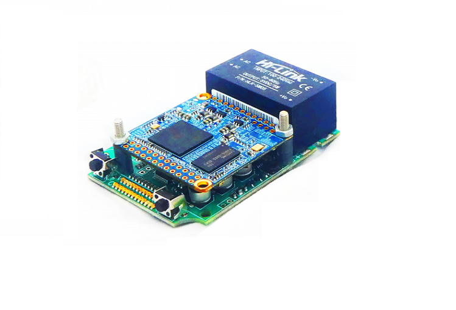

# DeviceV1
DeviceV1 is our second try to a "commercial grade" product, its basically a rework of version _00 to make it fit in smaller enclosure

## Specs
  - Single phase only
  - 15625Hz sample rate
  - 50A maximum current (about 35A RMS)
  - Working battery backup
  - Dual LED bars to show graphicaly current and voltage (Not sure if working, change from version to version)
  - Enclosure

## Drawbacks
  - Used battery need to be protected, if not it will overdischarge if left unplugged from mains
  - Not very efective shutdown, battery drains in few days if stored
