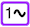
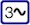

Se ha implementado una API para acceder en tiempo real a los parámetros característicos del oZm

La comunicación se realiza a través de peticiones  POST al servidor WEB integrado, obteniendo como resultado una respuesta en JSON. Por defecto, el servidor WEB requiere autorización (haber iniciado sesión en la WEB), aunque los accesos originados en <code>localhost</code> no tienen restricciones. 

Las series de datos que se almacenan y pueden ser consultadas son:

<table style="border:1px solid black">
  <tr>
    <th>Parámetro</th>
    <th >Tipo</th>
    <th>Descripción</th>
  </tr>

  <tr>
    <td>`rms_v` </td>
    <td>`real[1]`<br/>`real[3]`</td>
    <td>Tensión eficaz</td>
  </tr>

  <tr>
    <td>`rms_i`</td>
    <td>`real[1]`<br/>`real[4]`</td>
    <td>Corriente eficaz</td>
  </tr>
  <tr>
    <td>`active_power`</td>
    <td style="vertical-align:middle" rowspan="9">`real[1]`<br/>`real[3]`</td>
    <td>Potencia Activa total</td>
  </tr>
    <tr>
    <td>`apparent_power`</td>
    <td>Potencia Aparente total</td>
  </tr>
    <tr>
    <td>`power_factor`</td>
    <td>Factor de potencia</td>
  </tr>
    <tr>
    <td>`active_energy`</td>
    <td>Energía activa</td>
  </tr>
    <tr>
    <td>`fundamental_active_power`</td>
    <td>Potencia activa de la componente fundamental de 50/60 Hz</td>
  </tr>
    <tr>
    <td>`fundamental_reactive_power`</td>
    <td>Potencia reactiva de la componente fundamental de 50/60 Hz</td>
  </tr>
    <tr>
    <td>`fundamental_apparent_power`</td>
    <td>Potencia aparente de la componente fundamental de 50/60 Hz</td>
  </tr>
    <tr>
    <td>`fundamental_power_factor`</td>
    <td>Factor de potencia de la componente fundamental de 50/60 Hz</td>
  </tr>
    <tr>
    <td>`thd_v`</td>
    <td>Tasa de distorsión armónica de tensión</td>
  </tr>
    <tr>
    <td>`thd_i`</td>
    <td>`real[1]`<br/>`real[4]`</td>
    <td>Tasa de distorsión armónica de corriente</td>
  </tr>
    <tr>
    <td>`freq`</td>
    <td>`real`</td>
    <td>Frecuencia de red</td>
  </tr>
    <tr>
    <td>`phi`</td>
    <td>`real[1]`<br/>`real[3]`</td>
    <td>Ángulo de desfase entre la tensión y corriente</td>
  </tr>
    <tr>
    <td>`flag`</td>
    <td>`bool`</td>
    <td>Periodo marcado por contener eventos</td>
  </tr>
    <tr>
    <td>`harmonics_v`</td>
    <td style="vertical-align:middle" rowspan="2">`real[1][50]` <br/>`real[3][50]` </td>
    <td>Armónicos de tensión (del 1 al 50)</td>
  </tr>
    </tr>
    <tr>
    <td>`harmonics_i`</td>
    <td>Armónicos de corriente (del 1 al 50)</td>
  </tr>
</table>

Las funciones son fácilmente accesibles desde cualquier lenguaje, incluso pueden lanzarse desde linea de comandos usando el comando <code>curl</code>. Por defecto, el puerto es el 80 y debe indicarse la opción `--compress` ya que se usa compresión gzip.

`curl --compress localhost:port/functionName -d '{"param1":"value1", "param2":"value2", ...}'`

# getNodes
Devuelve información de los nodos de captura disponibles. No requiere ningún parámetro.

## Ejemplo

`curl localhost:8081/getNodes -d '{}'`

```JSON
  { 
    "IDs": [0, 1],
    "Names": ["Principal", "Secundario"],
    "State": [true, false],
    "Type": ["3Phase", "1Phase"],
    "SampleFreq":[15625, 15625],
    "NominalVoltage": [230, 230],
    "MaxCurrent": [20, 20],
    "NominalFreq": [50, 50]
  }
```

# getSeries
Devuelve una o varias series de datos correspondientes al rango que se indique.

## Entradas
<table style="border:1px solid black">
  <tr>
  <th>Opción</th>
    <th>Requerido</th>
    <th>Defecto</th>
    <th>Descripción</th>
  </tr>
  <tr>
  <td><pre>**Series**:string</pre></td>
    <td>`Si`</td>
    <td>`--`</td>
    <td> Nombre de las series a recuperar, separadas por comas. Por ejemplo `rms_v,rms_i` para obtener tensión y corriente eficaz</td>
  </tr>
  <tr>
  <td><pre>**Aggreg**:string</pre></td>
    <td>`Si`</td>
    <td>`--`</td>
    <td>Agregación preferida de origen, puede elegirse entre `3s`, `1m`, `10m` o `1h` para 3 segundos, 1 minuto, 10 minutos y 1 hora, respectivamente</td>
  </tr>
  <tr>
  <td><pre>**LastSample**:date</pre></td>
    <td>`No`</td>
    <td>0</td>
    <td>Fecha de la última muestra que se tiene. Se utiliza para recuperar de forma progresiva cuando `To` es igual a 0.</td>
  </tr>
  <tr>
    <td><pre>**To**:date</pre></td>
    <td>`No`</td>
    <td>0</td>
    <td>Fecha final de las muestras que se solicitan. Si se indica 0 se devolverón hasta el momento actual, comenzando en `LastSample` o aplicando `Period`</td>
  </tr>
  <tr>
    <td><pre>**Node**:string</pre></td>
    <td>`No`</td>
    <td>0</td>
    <td>Identificador de nodo sobre el que se realiza la consulta.</td>
  </tr>
  <tr>
    <td><pre>**Period**:integer</pre></td>
    <td>`No`</td>
    <td>0</td>
    <td>Rango de tiempo que se desea recuperar (en ms)</td>
  </tr>  
</table>

## Salidas
<table style="border:1px solid black">
  <tr>
  <th>Opción</th>
    <th>Requerido</th>
    <th>Defecto</th>
    <th>Descripción</th>
  </tr>
  <tr>
  <td><pre>**From**:date</pre></td>
    <td>`--`</td>
    <td>`--`</td>
    <td> Timestamp inicial (haya muestras para ese instante o no)</td>
  </tr>
  <tr>
  <td><pre>**To**:date</pre></td>
    <td>`--`</td>
    <td>`--`</td>
    <td>Timestamp final (haya muestras para ese instante o no)</td>
  </tr>
  <tr>
  <td><pre>**MaxSamples**:integer</pre></td>
    <td>`--`</td>
    <td>`--`</td>
    <td>Número de muestras que puede contener el intervalo devuelto como máximo</td>
  </tr>
  <tr>
    <td><pre>**Aggregation_Source**:string</pre></td>
    <td>`--`</td>
    <td>`--`</td>
    <td>Origen de los datos devueltos. Los datos intentan recuperarse de la agregación indicada, pero si el numero de resultados excediera los 10000, se retornarían de una agregación superior.</td>
  </tr>
  <tr>
    <td><pre>**Sampletime**:array</pre></td>
    <td>`--`</td>
    <td>`--`</td>
    <td>Lista de las marcas de tiempo para las que se devuelven datos</td>
  </tr>
  <tr>
    <td><pre>**Serie_name**:array</pre></td>
    <td>`--`</td>
    <td>`--`</td>
    <td>Lista de los valores de la serie en los instantes de tiempo de `Sampletime`. Este elemento (o elementos, si se piden varias series) tiene la misma longitud que `Sampletime`</td>
  </tr>  
</table>


## Ejemplo

# getSeriesAggreg
Devuelve un único valor por serie de datos solicitada, correspondiente a una operación de agregación aplicado en el rango que se indique.

## Entradas
<table style="border:1px solid black">
  <tr>
  <th>Opción</th>
    <th>Requerido</th>
    <th>Defecto</th>
    <th>Descripción</th>
  </tr>
  <tr>
  <td><pre>**Series**:string</pre></td>
    <td>`Si`</td>
    <td>`--`</td>
    <td>Nombre de las series a recuperar y la función a aplicar sobre cada una (separadas por comas) como por ejemplo `max(rms)_v` o `min(rms_i)` para obtener máximos de tensión y mínimos de corriente eficaz. Pueden repetirse series en la misma consulta para obtener varias funciones de agregación. Las funciones permitidas son `sum`, `max`, `min`, `avg`, `rms`, `and` y `or`, aunque no todos las funciones son aplicables a todas las series disponibles.</td>
  </tr>
  <tr>
  <td><pre>**Aggreg**:string</pre></td>
    <td>`Si`</td>
    <td>`--`</td>
    <td>Agregación preferida de origen. Puede elegirse entre `3s`, `1m`, `10m` o `1h` para 3 segundos, 1 minuto, 10 minutos y 1 hora, respectivamente</td>
  </tr>
  <tr>
  <td><pre>**To**:date</pre></td>
    <td>`No`</td>
    <td>`0`</td>
    <td>Fecha final de las muestras que se solicitan. Si se indica 0 se devolverón hasta el momento actual, comenzando en `LastSample` o aplicando `Period`</td>
  </tr>
  <tr>
    <td><pre>**Node**:string</pre></td>
    <td>`No`</td>
    <td>`0`</td>
    <td>Identificador de nodo sobre el que se realiza la consulta</td>
  </tr>
  <tr>
    <td><pre>**Period**:integer</pre></td>
    <td>`No`</td>
    <td>`0`</td>
    <td>Rango de tiempo que se desea recuperar (en ms).</td>
  </tr>
</table>


## Salidas
<table style="border:1px solid black">
  <tr>
  <th>Opción</th>
    <th>Requerido</th>
    <th>Defecto</th>
    <th>Descripción</th>
  </tr>
  <tr>
  <td><pre>**From**:date</pre></td>
    <td>`--`</td>
    <td>`--`</td>
    <td>Timestamp inicial (haya muestras para ese instante o no)</td>
  </tr>
  <tr>
  <td><pre>**To**:date</pre></td>
    <td>`--`</td>
    <td>`--`</td>
    <td>Timestamp final (haya muestras para ese instante o no)</td>
  </tr>
  <tr>
  <td><pre>**Samples**:integer</pre></td>
    <td>`--`</td>
    <td>`--`</td>
    <td>Número de muestras aplicadas en el cálculo.</td>
  </tr>
  <tr>
    <td><pre>**Serie_name**:string</pre></td>
    <td>`--`</td>
    <td>`--`</td>
    <td>Resultado de aplicar la función de agregación en la serie.</td>
  </tr>
</table>

# getSeriesNow
Devuelve el valor actual de una o varias series de datos. Esta petición no realiza consultas a la base de datos, si no que espera a que el bloque actual termine de ser procesado y devuelta los valores que contenga. Si un nodo esta desconectado no se devolverán valores.

Ademas de las series definidas anteriormente, se pueden requerir las siguientes, que no se almacenan en la base de datos, pero que son accesibles durante el analisis:

<table style="border:1px solid black">
  <tr>
    <th>Parámetro</th>
    <th>Tipo</th>
    <th>Descripción</th>
  </tr>
  <tr>
    <td>`wave_v` </td>
    <td  style="vertical-align:middle" rowspan="2">`real[1][n]`<br/>`real[3][n]`</td>
    <td>Valores de las `n` muestras asociadas a la onda de tension,</td>
  </tr>

  <tr>
    <td>`fft_v` </td>
    <td>Valores de los `n`coeficientes  de la transformada de Fourier en el canal de tension</td>
  </tr>
  <tr>
    <td>`wave_i`</td>
    <td  style="vertical-align:middle" rowspan="2">`real[1][n]`<br/>`real[4][n]`</td>
    <td>Valores de las `n`muestras asociadas a la onda de corriente</td>
  </tr>
  <tr>
    <td>`fft_i`</td>
    <td>Valores de los `n`coeficientes  de la transformada de Fourier en el canal de corriente</td>
  </tr>

</table>

## Entradas
<table style="border:1px solid black">
  <tr>
  <th>Opción</th>
    <th>Requerido</th>
    <th>Defecto</th>
    <th>Descripción</th>
  </tr>
  <tr>
  <td><pre>**Series**:string</pre></td>
    <td>`Si`</td>
    <td>`--`</td>
    <td> Nombre de las series a recuperar, separadas por comas. Por ejemplo `rms_v,rms_i` para obtener tensión y corriente eficaz</td>
  </tr>
  <tr>
    <td><pre>**Node**:string</pre></td>
    <td>`No`</td>
    <td>0</td>
    <td>Identificador de nodo sobre el que se realiza la consulta.</td>
  </tr>
</table>

## Salidas
<table style="border:1px solid black">
  <tr>
  <th>Opción</th>
    <th>Requerido</th>
    <th>Defecto</th>
    <th>Descripción</th>
  </tr>
  <tr>
  <td><pre>**Sampletime**:date</pre></td>
    <td>`--`</td>
    <td>`--`</td>
    <td>Timestamp de los valores devueltos</td>
  </tr>
  <tr>
    <td><pre>**Serie_name**:array</pre></td>
    <td>`--`</td>
    <td>`--`</td>
    <td>Lista de los valores de la serie en los instantes de tiempo de `Sampletime`.</td>
  </tr>  
</table>


# getEvents
Devuelve los eventos iniciados dentro del rango de fechas especificados.

## Entradas
<table style="border:1px solid black">
  <tr>
  <th>Opción</th>
    <th>Requerido</th>
    <th>Defecto</th>
    <th>Descripción</th>
  </tr>
  <tr>
  <td><pre>**LastEvent**:date</pre></td>
    <td>`No`</td>
    <td>0</td>
    <td>Fecha del último evento que se tiene. Se utiliza para recuperar de forma progresiva cuando `To` es igual a 0.</td>
  </tr>
  <tr>
    <td><pre>**To**:date</pre></td>
    <td>`No`</td>
    <td>0</td>
    <td>Fecha final de los eventos que se solicitan. Si se indica 0 se devolverán hasta el momento actual, comenzando en `LastEvent` o aplicando `Period`</td>
  </tr>
  <tr>
    <td><pre>**Node**:string</pre></td>
    <td>`No`</td>
    <td>0</td>
    <td>Identificador de nodo sobre el que se realiza la consulta.</td>
  </tr>
  <tr>
    <td><pre>**Period**:integer</pre></td>
    <td>`No`</td>
    <td>0</td>
    <td>Rango de tiempo que se desea recuperar (en ms)</td>
  </tr>  
</table>

## Salidas
<table style="border:1px solid black">
  <tr>
  <th>Opción</th>
    <th>Requerido</th>
    <th>Defecto</th>
    <th>Descripción</th>
  </tr>
  <tr>
  <td><pre>**StartTime**:date</pre></td>
    <td>`--`</td>
    <td>`--`</td>
    <td>Timestamp del inicio del evento</td>
  </tr>
  <tr>
  <td><pre>**Duration**:integer</pre></td>
    <td>`--`</td>
    <td>`--`</td>
    <td>Duracion del evento en muestras. (La duracion en tiempo puede calcularse consultando la frecuencia de muestreo del nodo).</td>
  </tr>
  <tr>
  <td><pre>**Type**:string</pre></td>
    <td>`--`</td>
    <td>`--`</td>
    <td>Tipo de evento, puede ser "DIP", "SWELL", "RVC", "INTERRUPTION", "GLITCH" (Todavia no implementado)</td>
  </tr>
  <tr>
  <td><pre>**Voltage**:string</pre></td>
    <td>`--`</td>
    <td>`--`</td>
    <td>Variacion de tension, con respecto a la tension de referencia para cada tipo de evento (En "RVC" la tensión de referencia es la media de los últimos 100 ciclos, en "DIP", "SWELL" y "INTERRUPTION" la referencia es la tensión nominal, en "GLITCH" la referencia es la tensión que debería de haber en cada instante de la señal.</td>
  </tr>
  <tr>
  <td><pre>**Percentage**:string</pre></td>
    <td>`--`</td>
    <td>`--`</td>
    <td>Variacion de tension en porcentage respecto al valor de referencia del evento.</td>
  </tr>
</table>
