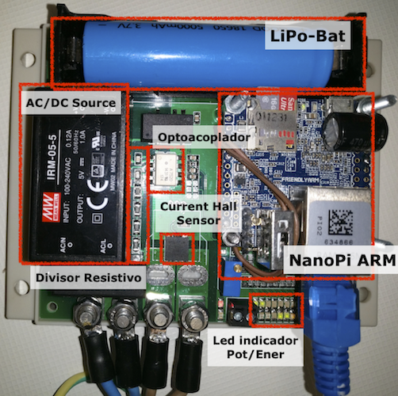

Existen varias versiones de hardware, cada una para un uso especifico y con unos objetivos. El servicio openZmeter reconoce el tipo de hardware conectado para comunicarse de forma correcta.

## Home edition
Esta versión esta pensada para ser compacta y fácil de instalar en redes monofasicas domesticas, proporcionando todas las variables del suministro basicas.

Todos los elementos del sistema están integrados en un único modulo. El usuario accede a la información a través de la interface WEB.

Cada modulo integra el hardware de captura, la fuente de alimentacion, una placa con linux para hacer el analisis, almacenar los datos y permitir el acceso WEB. 

Aunque hay varias revisiones del hardware, todas son compatibles. Las caracteristicas basicas son:
* Frecuencia de muestreo fija de 15625Hz (64uS entre muestras).
* Bateria incorporada

## Distributed edition
* Medicion de 1 canal de tension y uno de corriente.
* Tensión de entrada de 0 a 600v (Escala ajustable según necesidades).
* Análisis en el propio modulo.
* Frecuencia de muestreo de 5000Hz (200uS entre muestras).
* Inicio rápido. Los variables de suministro estan disponibles tan pronto el modulo recibe alimentacion.
* Alimentacion externa. El modulo se alimenta y se comunica con el host a traves de un bus de 2 hilos.
* Hasta 255 modulos por bus.
* Consumo reducido (< 0.5W) por modulo.

## Version Analizador
* 3 canales de tension y 4 de corriente.
* Frecuencia de muestreo 1MHz por canal.
* Analisis en el mismo modulo de las variables de suministro.
* Transmision de fragmentos a unidad de control.
*
