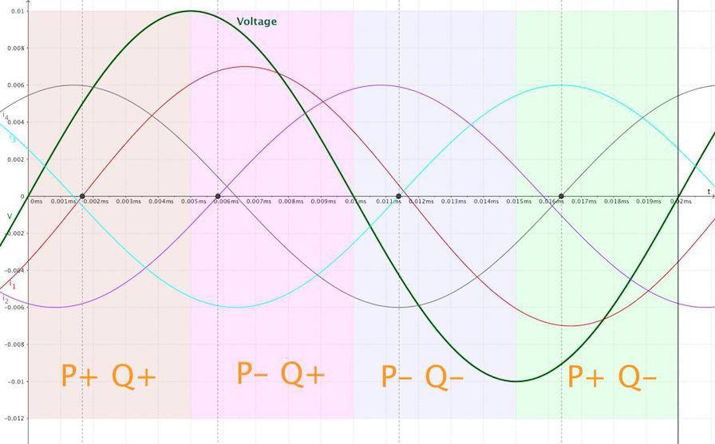

El sistema **oZm** está diseñado para medir un buen puñado de variables eléctricas. Entre las más básicas o fundamentales se encuentran la tensión eficaz, la corriente eficaz, la potencia activa o el factor de potencia. Otras variables más avanzadas son obtenidas atendiendo a la normativa internacional y nacional relacionada con calidad eléctrica o medición de energía como son las normas [IEC 61000-4-30](https://webstore.iec.ch/preview/info_iec61000-4-30%7Bed3.0.RLV%7Den.pdf) y la [EN 50160](http://www.aenor.es/aenor/normas/normas/fichanorma.asp?tipo=N&codigo=N0055031&pdf=#.WZQp3XdJZsY). Aunque no todas las definiciones de la norma[[se encuentran implementadas|Estandar IEC61000-4-30]], oZm es un proyecto en constante evolución, por lo que se añaden nuevas funcionalidades continuamente para cumplir la norma lo más fielmente posible. Todo lo anterior es posible gracias al diseño _opensource_, de forma que se pueden ampliar las funcionalidades y el alcance de las mediciones realizadas mediante nuevos algoritmos o mejoras de los ya existentes.

Fundamentalmente, se desea que el sistema trabaje como:
* [Analizador de calidad eléctrica (*power quality*)](#Analizador de calidad eléctrica)
* [Contador de energía eléctrica (*smart meter*)](#Contador de energía eléctrica)

## Analizador de calidad eléctrica
La calidad eléctrica, calidad de suministro o calidad de energía eléctrica de una instalación es un concepto que tiene que ver con la tensión, la frecuencia y la forma de onda suministrada. Se entiende que se dispone de una _buena_ calidad eléctrica cuando la tensión suministrada se mantiene dentro de unos rangos predefinidos de manera estable en el tiempo. Aunque la calidad de suministro perfecta sea imposible de conseguir, se acepta que cuánto más cerca se esté de la tensión nominal 230V[[1]](#f1), frecuencia nominal 50Hz[[1]](#f1) y forma de onda senoidal, se dispondrá de un mejor suministro eléctrico. Por otro lado, hay que destacar la importancia de la calidad en el suministro ya que afecta directamente al funcionamiento de los dispositivos de una instalación eléctrica. Cuánto peor es la calidad, mayor es la probabilidad de sufran averías o malfuncionamiento,  menor sea su vida útil o fallen prematuramente o simplemente no funcionen. Por todo lo anterior, es aconsejable y necesario poder contar con medidas precisas de las variables relacionadas con la calidad eléctrica. Estas medidas, por supuesto, deben cumplir con la normativa específica y que se explica en la sección [[Estandar IEC61000-4-30]].

## Contador de energía eléctrica
Un aspecto importante en una instalación es la correcta medición del consumo o generación de energía eléctrica. Tradicionalmente, las compañías eléctricas han instalado un [contador electromecánico tipo Ferraris](https://es.wikipedia.org/wiki/Vatihor%C3%ADmetro) con capacidades limitadas para la medición en sistemas con alto contenido en armónicos y con muy escasos mecanismos de comunicación. Por otro lado, la penetración de energía renovables en los últimos años, así como la desregulación del mercado eléctrico y los precios de mercado en base horaria, han animado a las compañías a incentivar la implantación de los denominados _contadores inteligentes_ o _smart meters (SM)_. Estos dispositivos permiten una medición local horaria con acceso remoto para una posterior facturación basada en franjas horarias y periodos semanales o estivales. Por tanto, un SM al uso registra el consumo de energía eléctrica en intervalos de una hora (normalmente) y envía dicha información a la compañía para su monitorización y cobro. El concepto de SM va más allá e incluso permite una comunicación bidireccional entre el centro de control y el propio contador. Para ello se pueden usar diferentes tecnologías como [PLC](https://en.wikipedia.org/wiki/Power-line_communication), Wifi, 4G, etc.

## Parámetros eléctricos
Gracias a la adquisición de la onda de tensión y corriente mediante un [[AFE|Hardware]] específico, es posible calcular los parámetros eléctricos más importantes de un sistema eléctrico. Además, debido al diseño de oZm, la precisión alcanzada en dichas medidas cumple el estándar IEC 61000-4-30. Por ejemplo, la tensión es medida con una precisión del 0.1% y la frecuencia con una precisión de 10 mHz.

<!---
Usamos el servicio codecog para generar latex online
http://www.codecogs.com/latex/integration/htmlequations.php
--->

#### Tensión Eficaz o RMS 

&nbsp;&nbsp;&nbsp;&nbsp;  

  donde N es el número total de muestras considerado y  se corresponde con la muestra enésima de tensión. Se demuestra que para una onda completamente senoidal, .

#### Corriente Eficaz o RMS

&nbsp;&nbsp;&nbsp;&nbsp;

  donde N es el número total de muestras considerado y  se corresponde con la muestra enésima de corriente. Se demuestra que para una onda completamente senoidal, .

#### Potencia activa
La potencia activa consumida se define como la energía por unidad de tiempo que es aprovechada por un sistema eléctrico para producir trabajo útil. Su valor es igual al producto de la tensión y la corriente en sistemas de continua , mientras que en sistema de alterna es el valor medio del producto de la onda de corriente por la onda de tensión:

&nbsp;&nbsp;&nbsp;&nbsp;

Para sistemas digitales, su expresión es la siguiente:

&nbsp;&nbsp;&nbsp;&nbsp;

donde  es la muestra enésima de tensión y  es la de corriente.
Hay que tener en cuenta que el valor puede ser positivo o negativo, según se consuma o se genere energía según la siguiente figura:

El trazo verde oscuro se corresponde con la tensión y los otros 4 trazos se corresponde con 4 posibles corrientes (desde  hasta ). En dicha figura aparecen coloreadas las 4 regiones posibles, indicándose no sólo el valor que puede tomar la potencia activa P, sino también la potencia reactiva Q.

##### Potencia activa fundamental 
En presencia de armónicos, la potencia activa es la suma de las contribuciones de cada armónico:

&nbsp;&nbsp;&nbsp;&nbsp;  

  donde   es la potencia activa fundamental y  es la potencia activa de los armónicos.

Es importante destacar que tanto la potencia fundamental como la de armónicos puede tomar valores positivos o negativos en función del tipo de instalación y su uso (consumo/generación).

#### Potencia reactiva
La potencia reactiva es un concepto matemático que sólo aparece en sistema de corriente alterna. Su valor es:

&nbsp;&nbsp;&nbsp;&nbsp;

A pesar de ser un concepto que surge de la matemática asociada a la transformación de la tensión e intensidad al plano complejo (transformación de [Steinmetz](https://es.wikipedia.org/wiki/Charles_Proteus_Steinmetz)) y su uso en [fasores eléctricos](https://es.wikipedia.org/wiki/Fasor), la potencia reactiva nos da una idea de la cantidad de corriente que absorbe una carga cuando crea campos magnéticos (bobinas) o campos eléctricos (condensadores) en su funcionamiento normal. Una carga resistiva pura no crea campos eléctricos o magnéticos, por tanto no consume potencia reactiva.  

El valor de Q puede ser positivo o negativo en función de si es una carga inductiva o capacitiva (véase la figura en [Potencia activa](#Potencia activa))

##### Potencia reactiva fundamental

En la presencia de armónicos, la potencia reactiva a considerar será el resultado de las componentes fundamentales de corriente y tensión tal y como establece al criterio adoptado por la norma IEEE1459, aunque puede ser revisado o actualizado a conveniencia[[2]](#f2).

&nbsp;&nbsp;&nbsp;&nbsp;

Es importante destacar que tanto la potencia fundamental como la de armónicos puede tomar valores positivos o negativos en función del tipo de instalación y su uso (consumo/generación).

#### Potencia aparente
La potencia aparente es un concepto matemático que surge de la multiplicación de la tensión y la corriente en el plano complejo. Así como la potencia instantánea  es el resultado del producto de tensión y corriente en el dominio del tiempo (siendo el resultado una onda alterna), en el plano complejo, este producto también es un número complejo:

&nbsp;&nbsp;&nbsp;&nbsp;

  donde  es la unidad imaginaria .

A partir de la definición de potencia aparente compleja, se puede obtener el valor absoluto o magnitud de la potencia aparente

&nbsp;&nbsp;&nbsp;&nbsp;

La magnitud de la potencia aparente siempre es positiva por definición. 

##### Potencia aparente fundamental
Al igual que sucede con la potencia activa y reactiva, en presencia de armónicos se puede definir el concepto de potencia aparente fundamental

&nbsp;&nbsp;&nbsp;&nbsp;

De esta forma, la potencia aparente total se puede expresar como

&nbsp;&nbsp;&nbsp;&nbsp;  

donde   es la denominada potencia aparente no fundamental.

#### Factor de potencia
Como consecuencia de las definiciones anteriores, aparece un concepto nuevo denominado factor de potencia o coseno del ángulo que forman la onda de tensión y corriente. Se puede ver fácilmente que 

&nbsp;&nbsp;&nbsp;&nbsp; 

  De esta forma, el factor de potencia nos da el grado de aprovechamiento energético de una instalación eléctrica. Cuanto mayor sea, es decir, cuanto más próximo sea a la unidad, mejor estaremos aprovechando la disponibilidad energética de la fuente de alimentación. Se comprueba que un factor de potencia bajo, produce ineficiencias en la instalación como mayores pérdidas de energía por efecto Joule (calentamiento de conductores) o sobredimensionamiento de conductores debido a corrientes elevadas.  
Su valor oscila entre -1 para cargas completamente capacitivas y +1 para cargas completamente inductivas, aunque es frecuente encontrarse en los textos únicamente el valor absoluto con una indicación _(c)_ para capacitivo o una _(i)_ para inductivo.

#### Tasa de distorsión armónica THD
La tasa de distorsión armónica (_Total Harmonic Distortion_ o _THD_) proporciona una medida del nivel de contenido espectral en una onda. Es un concepto ampliamente utilizado en ingeniería eléctrica para valorar la distorsión que introducen los armónicos en la tensión o intensidad. La norma indica que se tenga en cuenta hasta el armónico de orden 50 (2500Hz). Se define tanto para la tensión

&nbsp;&nbsp;&nbsp;&nbsp;   

como para la corriente

&nbsp;&nbsp;&nbsp;&nbsp;   

#### Frecuencia
La medición de frecuencia se realiza mediante un algoritmo de paso por cero (_zero crossing_) y permite obtener una precisión suficiente como para cumplir con la indicada por la norma IEC 61000-4-30 de 10 mHz. El algoritmo de paso por cero tiene en cuenta tanto el ruido de la señal como los posibles interarmónicos presentes en la misma. Sólo se realiza en el canal de tensión.

#### Energía activa 
Una de las funciones principales de oZm es la medición de energía activa tal y como establece la norma IEC 62052-11 y IEC 62053-21. Para ello se realizan agregaciones de la potencia activa para periodos de 1 hora. La expresión de la energía es

&nbsp;&nbsp;&nbsp;&nbsp;  

donde  es el tiempo de agregación (1 hora en nuestro caso). Las unidades obtenidas son Watios·hora Wh. 
Es importante resaltar que oZm mide la energía total, incluyendo la que proviene de todos los armónicos. 

#### Energía reactiva
La energía reactiva es medida por oZm teniendo en cuenta que sólo se calcula la debida a las componentes fundamentales de la corriente y la tensión. Por tanto, **NO** se sigue el criterio de Budeanu[[3]](#f3) dado por

&nbsp;&nbsp;&nbsp;&nbsp;  

sino que se presenta la energía reactiva como la obtenida de la componente fundamental

&nbsp;&nbsp;&nbsp;&nbsp;  

#### Notas

<small id="f1">[[1]](#a1) En europa los valores nominales son de 230V y 50Hz, pero en otras partes del mundo pueden variar. </small>  
<small id="f2">[[2]](#a2) Para una mayor información acerca de teoría de potencia en sistemas no senoidales, puede consultarse [aquí](http://citeseerx.ist.psu.edu/viewdoc/download?doi=10.1.1.625.7591&rep=rep1&type=pdf).</small>  
<small id="f3">[[3]](#a3) Ver sección _A2. The use of varmeters in the presence of distorted waveforms_ de la IEEE1459.</small>
