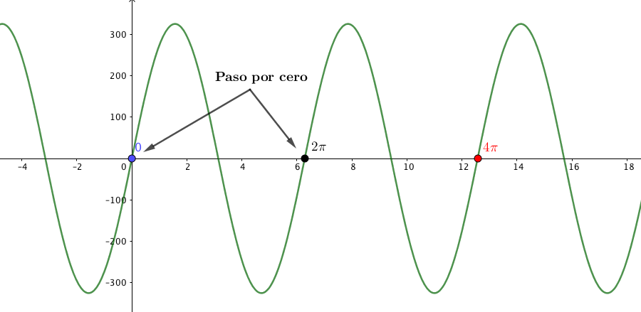
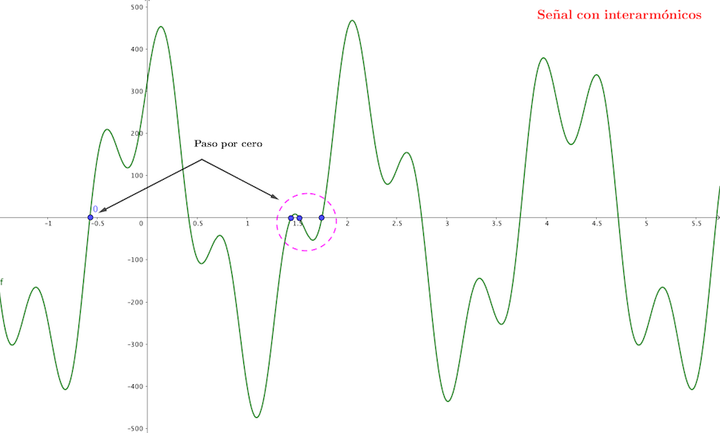

La norma [[IEC 61000-4-30|Estandar IEC61000-4-30]] establece que casi todas las medidas se realicen, de forma general, empleando periodos de agregación de 10 ciclos. Alternativamente,  para la frecuencia de red se establece un periodo de agregación mayor, concretamente de 10 segundos. 

La determinación de la frecuencia de red es una tarea importante para determinar la seguridad, estabilidad y eficiencia de una instalación eléctrica. Medidas precisas y confiables permiten un mejor control del sistema, desconexión y reconexión de cargas, así como una mejor protección eléctrica. Existe, por tanto, una necesidad de real de medir la frecuencia en sistemas eléctricos de manera precisa y en tiempo real, 
 teniendo en cuenta que además pueden coexistir formas de onda con una presencia de ruido eléctrico y armónicos.

En la actualidad, existen diferentes propuestas que obtienen un buen comportamiento. La más simple y conocida  es la técnica de paso por cero (_zero crossing_ en inglés). Otras técnicas como la transformada discreta de Fourier (DFT), error cuadrático medio o filtros de Kalman también han dado buenos resultados, pero introduciendo una mayor complejidad algorítmica y computacional. Una buena revisión del estado del arte se puede encontrar [aquí](power_system_freq_meas.pdf).

En el caso de ondas perfectamente senoidales, el paso por cero es fácil de determinar ya que coincide con el cambio de signo de la señal.  

Sin embargo, en un sistema real, lo habitual es encontrar ondas distorsionadas, donde el paso por cero puede no estar bien definido debido a la presencia de ruido, introducido bien por el mismo ADC o por la presencia de armónicos e interarmónicos. Esta circunstancia hace que en las zonas próximas al paso por cero se puedan producir varios cruces o transiciones entre valores positivos y negativos. Teniendo en cuenta esta problemática, es necesaria la implementación de medidas que mitiguen estas distorsiones. 

En la implementación realizada en oZm, se hace uso de técnicas basadas en filtros digitales que suavizan la forma de onda y eliminan los posibles cruces múltiples por cero que se puedan producir, a la vez que permiten determinar con exactitud dónde se produce el paso por cero y así hallar con precisión la frecuencia de red.

El algoritmo desarrollado filtra las muestras de entrada, estando centrado en la frecuencia de red de forma que elimina de paso el posible ruido de cualquier otra frecuencia. La cantidad de filtros y los parámetros de estos pueden controlarse fácilmente para adaptarlos a las necesidades concretas. Por defecto se aplican 5 filtros paso banda centrados en la frecuencia de red [[1]](http://www.musicdsp.org/files/Audio-EQ-Cookbook.txt).
